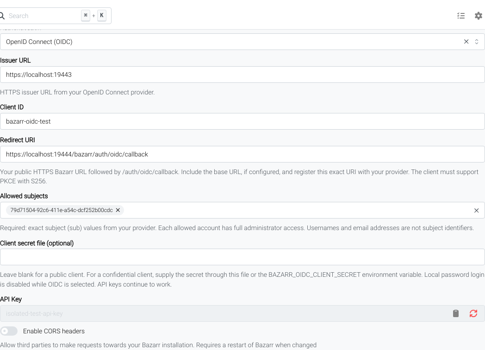
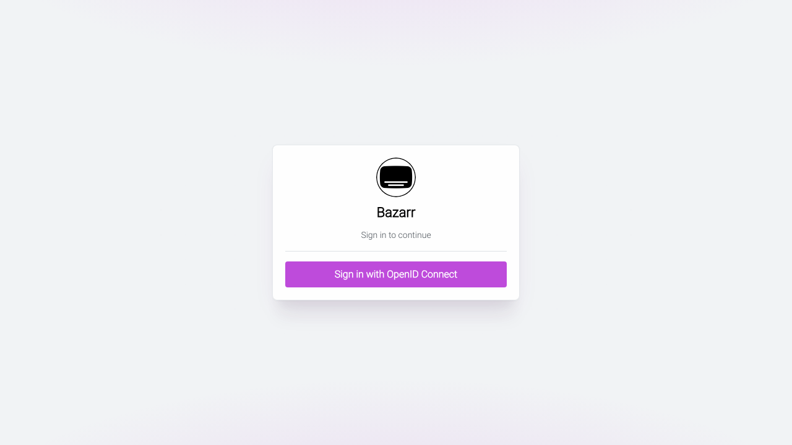

# OpenID Connect authentication

OIDC lets a configured identity provider handle browser login. Every allowed identity has full access to the Bazarr instance. OIDC does not add multiple user roles. Existing API keys continue to work for integrations.

## Provider setup

Create an OpenID Connect client with Authorization Code flow and PKCE using S256. Register the exact callback URL:

```text
https://bazarr.example.com/auth/oidc/callback
```

Include Bazarr's base URL if one is configured. For example, an instance at `https://example.com/bazarr` needs `https://example.com/bazarr/auth/oidc/callback`.

The issuer, discovery endpoints, and callback must use HTTPS. HTTP callbacks are not supported. TLS can terminate at a reverse proxy. Keep certificate verification enabled and use the normal Requests CA bundle configuration if your provider uses a private certificate authority.

The provider must issue signed ID tokens. Supported signing algorithms are defined in `bazarr/app/oidc.py`; symmetric and unsigned ID tokens are rejected. The client requests the `openid`, `profile`, and `email` scopes. Access is checked against the subject identifier, not the username or email address.

## Bazarr setup

In **Settings → General → Security**, select **OpenID Connect (OIDC)** and enter:

- **Issuer URL:** the exact `issuer` value in your provider's discovery document.
- **Client ID:** the client identifier registered with your provider.
- **Redirect URI:** the exact HTTPS callback registered above.
- **Allowed subjects:** the exact `sub` values of the accounts that may administer this instance. At least one subject is required.
- **Client secret file:** optional. Leave it blank for a public PKCE client. For a confidential client, mount its secret as a file readable by Bazarr and enter the path. Alternatively, supply `BAZARR_OIDC_CLIENT_SECRET` in the process environment. The file takes precedence over the environment variable. The secret is not saved in `config.yaml` or returned by the settings API.

Save the settings and select **Sign in with OpenID Connect**. Local password login is disabled while OIDC is selected. OIDC login failures do not fall back to a local password.





The equivalent configuration is:

```yaml
auth:
  type: oidc
  oidc_issuer: https://identity.example.com
  oidc_client_id: bazarr
  oidc_redirect_uri: https://bazarr.example.com/auth/oidc/callback
  oidc_allowed_subjects:
    - provider-subject-identifier
  oidc_client_secret_file: ''
```

### Pocket ID

Create an OIDC client in Pocket ID. Set the callback to the exact Bazarr redirect URI and require PKCE. A public client does not need a client secret. If you use a confidential client, provide its secret through a secret file or `BAZARR_OIDC_CLIENT_SECRET`.

Restrict the client to the intended users or groups in Pocket ID. Also copy each allowed account's immutable subject identifier into Bazarr's **Allowed subjects** field. Use the subject from Pocket ID's user record or a verified ID token; do not substitute a username or email address. The Bazarr issuer must match Pocket ID's discovery document.

## Sessions and logout

OIDC uses Bazarr's existing server-side session registry. Provider tokens and PKCE verifiers are not placed in the browser cookie. Logout revokes the Bazarr session, including saved copies of its cookie. It does not log the user out of their identity provider or other applications. A later sign-in can therefore reuse the provider's session.

Sessions expire according to the session registry in `bazarr/app/form_sessions.py` and are cleared when Bazarr restarts. Changing OIDC configuration revokes browser sessions. Changes to provider-side permissions take effect on the next provider authentication; they do not send a revocation event to an existing Bazarr session.

## Recovery

If the provider or OIDC configuration prevents login, stop Bazarr, edit `auth.type` in `config/config.yaml` to restore the previously configured `form` or `basic` method, and restart Bazarr. The existing local credentials are retained. Keep network access restricted while you recover. A valid API key also permits an administrator to correct the settings through the existing settings API.

## Dependencies and validation

The OAuth client is the existing vendored `requests-oauthlib` library. ID token verification uses vendored `python-jose`, `rsa`, `ecdsa`, and `pyasn1`, with the existing `six` dependency. These packages run without a compiled cryptography dependency. Their versions and licenses are retained in the matching `libs/*.dist-info` directories. No runtime package installation is required.

The authentication tests in `tests/bazarr/test_oidc.py` use an independent mock provider and actual RSA/ECDSA signatures. They check PKCE, required claims, signature verification, issuer and audience restrictions, nonce and state, access control, callback expiry and replay, key rotation, logout, API access, and unsafe redirects. Frontend tests cover the OIDC login button, error messages, and settings fields.
